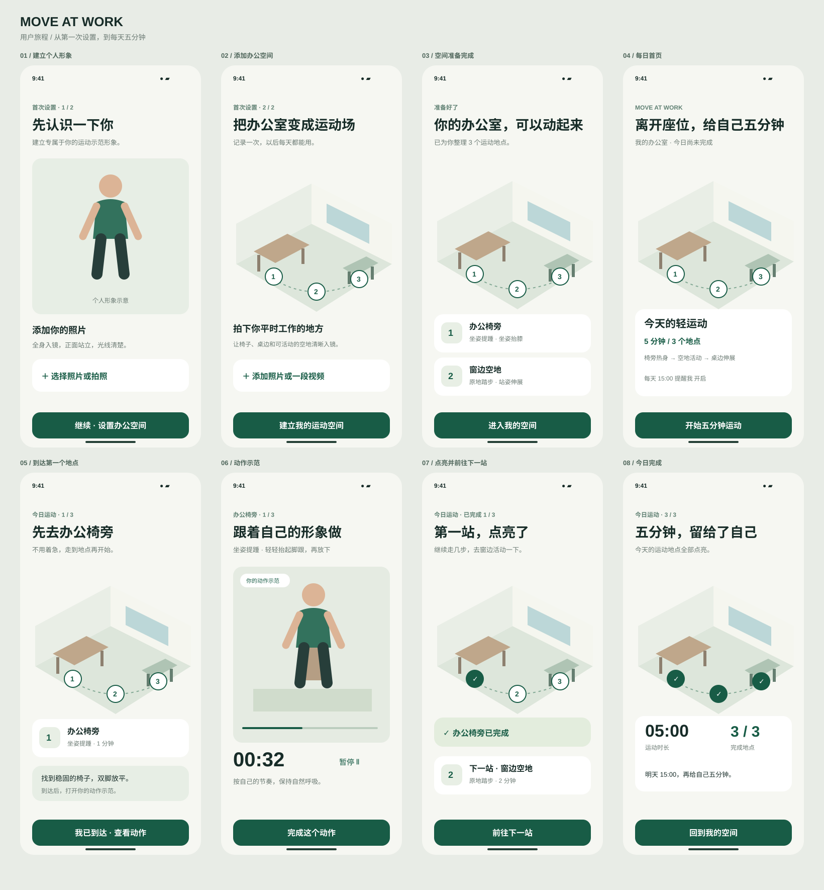

# Just Standup (Move at Work)

A workplace movement demo: turn a familiar office into a personalized five-minute workout route.

## Current design and technical plan

- [Technical design (中文)](docs/TECHNICAL_DESIGN.md): reconstruction, neon rendering, motion demonstrations, data contracts, and demo milestones.
- [Latest approved UI — 01_UI.html](docs/reference/01_UI.html): download the HTML file and open it in a browser to view the five-screen design. GitHub displays source rather than running the HTML.

The SVG screens below are earlier drafts; the linked HTML is the current UI reference.

## User journey

1. **Create a personal model.** Establish the user's body parameters and personalized appearance.
2. **Reconstruct the workspace.** Build a 3D office scene from photos or a video.
3. **Identify workout spots.** Identify suitable locations and objects, such as chairs, desk edges, railings, and open floor space.
4. **Prepare movement demonstrations.** Match exercises to each spot and show the personalized character performing them in that setting.
5. **Follow the map and check in.** Visit each spot, watch the demonstration, complete the movement, and light up the map until the daily session is complete.

The first four steps are primarily setup work. Daily sessions combine prepared movements into a five-minute route.

## UI draft

Eight static mobile screens cover setup, the office map, a daily session, arrival, movement demonstration, spot completion, and session completion.

Open `outputs/preview.html` locally to browse the overview. Individual SVG screens are in `outputs/`.

## Current status

Concept and static UI draft only. The character and office illustrations are placeholders. No reconstruction model, motion generation, video playback, or interactive application has been implemented. The draft has not yet been imported into Figma.

For the initial demo, use a fixed five-minute routine. AR, real-time motion correction, pain assessment, and training-goal personalization are outside the current scope.
