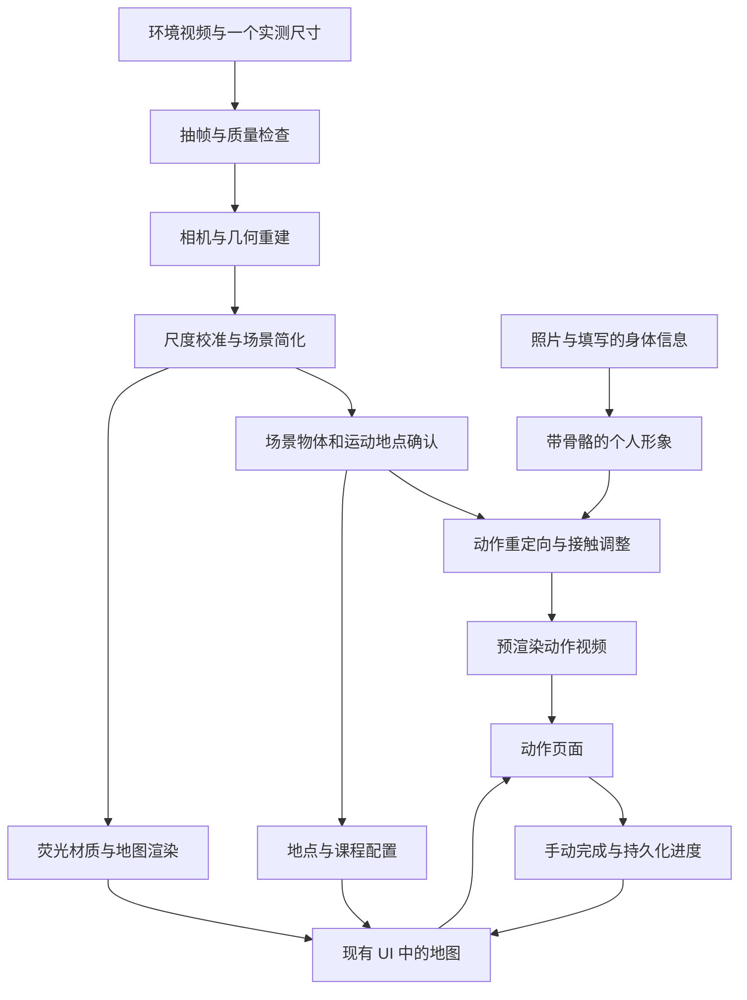

# Just Standup 技术方案与 Demo 实施文档

日期：2026-10-14 · 版本：v0.1（实施设计，尚未完成模型实测）

产品名采用最新 Notion 页面标题 **Just Standup**；GitHub 仓库沿用 `maxx1031/move-at-work`，本次不重命名仓库。

## 1. 产品目标与已确认边界

把用户熟悉的办公空间变成可识别、可探索的虚拟运动场：真实空间提供几何结构，虚拟世界改变材质、灯光和任务反馈。用户每天打开手机，完成一组约五分钟的运动，依次点亮空间中的地点。

产品五步：①建立个人模型；②重建办公环境；③识别运动地点；④准备个性化动作示范；⑤地图引导与打卡。前四步主要发生在首次设置，日常使用复用资产并组合动作。

**本轮 demo：一个办公区域、2–3 个运动点、固定动作组合、手动确认到达与完成。** 不加入 AR、自动室内定位、实时动作纠正、疼痛诊断或自动评估家具承重。个人信息与环境重建可并行准备；工程上先完成环境到地图的闭环，再接人物。

当前材料：
- 最新 UI：项目目录中的 `01_UI.html`，包含空间就绪、每日首页、前往第一站、动作示范、今日完成五个页面。
- 第 2 页地图当前为 SVG 等距绘图，含深色家具、青色轮廓、荧光绿任务点、路径和脉冲动画；它尚未连接真实重建场景。
- 远端仓库目前是早期 README 与八页浅色 SVG 草稿，不应继续将其视为最新 UI。
- 尚未收到或处理环境视频；本文件中的模型效果、耗时、资源占用均不代表已验证结果。

## 2. 两种展示模式

### 2.1 同机位进入运动世界

Notion 中的关键演示：同一视角点击 `Enter workout mode`，办公室逐渐变暗，栏杆发光，地面出现训练圈。

实现方式：选择一个已标定的视频关键帧，保存对应相机参数。用该相机渲染虚拟场景，使地面、窗边、栏杆与原画面对齐，再过渡到运动材质。若采用照片编辑或 2D 合成，只能说明同视角概念效果，不宣称获得可自由移动视角的三维场景。

### 2.2 第 2 页的办公地图

同一个三维场景使用正交俯视相机，隐藏遮挡地图的屋顶或前侧墙面，展示结构、路线和任务点。地图相机与同机位相机独立保存，世界坐标保持一致。

## 3. 系统数据流



离线资产构建负责计算量较大的重建、场景处理和视频渲染；前端负责资产加载、地图交互、视频播放和打卡。一次完成动作无需再次运行重建或生成模型。

## 4. 视频采集与预处理

起始拍摄建议：45–90 秒原始视频，1080p 或 4K，正常速度、不剪辑；缓慢平移和绕行，让桌椅、栏杆、地面从多个角度可见。不要只在原地旋转手机；避免切换焦段、快速甩动和移动家具。补充一个实测长度，例如桌宽，用于恢复实际尺度。

用 FFmpeg 抽取候选帧，再按清晰度、视角覆盖和重复程度筛选。抽帧数量按视频和 GPU 显存调整，不把全部视频帧直接送进模型。保留原视频时间戳、原图尺寸和任何缩放/裁剪变换。

交付物：`frames/`、`frames_manifest.json`。检查重点：关键物体至少有多个可用视角，地面可见，遮挡或反光严重的区域单独标记。

## 5. 重建与场景资产

### 5.1 几何初稿

建议先用 VGGT 估计相机内外参、深度与点图，形成可检查的空间初稿。若相机配准或结构不稳定，再评估 COLMAP 的 SfM/MVS 流程。两者是可替换的重建方案，不要求机械串联运行。

交付物：点云、相机参数、重建预览，以及低置信度区域记录。成功标准是家具位置关系和房间结构可识别，不是已经产生漂亮的游戏资产。

### 5.2 统一尺度和坐标

根据实测长度校准尺度；地面作为高度零点。应用坐标统一为米制、右手系、Y 轴向上，地面在 XZ 平面。记录原始重建坐标到应用坐标的变换矩阵。人物、接触点、路线、相机必须使用同一套变换；Blender 与模型输出的轴向差异要显式转换。

### 5.3 简化与人工修正

地面和墙面拟合平面；桌椅保留轮廓、朝向与主要尺寸；栏杆用圆柱或曲线补建。清理漂浮点、破洞和不影响识别的杂物。原始扫描几何保留用于对照，简化几何用于浏览器显示。

使用 Blender 整理并导出 `office.glb`，给对象稳定命名，例如 `chair_01`、`rail_01`。首次 demo 允许人工标注和建模修正，并记录哪些结构经过补齐。不能为了好看移动家具、扩大通道或把不可见区域描述为实测结果。

## 6. 荧光渲染与现有 UI 集成

推荐 Web 技术栈：TypeScript + Three.js；UI 是否使用 React 可随现有项目选择，不构成模型依赖。现有 HTML 是打包的页面视觉材料，应提取布局和样式后建立可维护组件，而非将其视为已经实现的业务应用。

| 视觉需求 | 实现 |
|---|---|
| 深色底与家具 | 复用 UI 的 `#0B0F0E`、`#0E1412` 等颜色 |
| 青色轮廓 | 简化网格的 EdgesGeometry，主色 `#5EE6D0` |
| 荧光绿色焦点 | `#C6FF3D`，用于当前或完成地点 |
| 发光栏杆 | 对应网格的 emissive 材质与适量 Bloom |
| 地面任务圈 | 贴地圆环，轻微高度偏移避免闪烁 |
| 路线流动 | 绕过家具的路径线及动画虚线/着色器 |
| 完成反馈 | 更新地点状态、光圈及局部亮度 |

仅给主要几何边缘描线，避免把扫描网格所有三角边显示出来。使用 GLTFLoader 加载资产，将地图占位 SVG 替换为 WebGL canvas，保留标题、任务卡、提醒和开始按钮。

任务点存储三维位置，使用射线拾取或坐标投影完成点击。优先固定地图相机，之后再开放受限旋转。移动端控制分辨率与 Bloom 成本；低性能设备关闭 Bloom 时仍需能辨认任务点。

## 7. 运动地点识别与配置

采用“候选识别 → 三维关联 → 人工确认”的流程。视觉模型可以提出椅旁、桌边、栏杆旁、空地等候选；不能仅用画面分类结果推断承重能力。首版人工确认地点和活动空间即可，不把全自动分割作为地图上线前置条件。

每个地点绑定物体 ID、站位、朝向、活动范围和动作 ID。二维分割结果若使用，需结合相机和深度映射到同一三维坐标系，并做跨视角去重。路线首版手工画在可行走区域；以后再接导航网格。

以下为建议数据契约，坐标仅为结构示例，非真实场景测量：

```json
{
  "sceneId": "office_demo",
  "sceneVersion": "v1",
  "units": "meters",
  "upAxis": "Y",
  "spots": [{
    "id": "spot_01",
    "objectId": "chair_01",
    "position": [1.0, 0.0, 2.0],
    "headingRadians": 0.0,
    "clearanceRadius": 0.7,
    "reviewed": true,
    "exerciseIds": ["seated_warmup"]
  }]
}
```

## 8. 个人形象与动作示范

个人形象支线：照片与用户填写的身高等信息 → 参数化人体或其他带骨骼 avatar → 外观与尺寸调整。体重等不直接等同于 SMPL 形状参数；照片估计不能冒充实际测量。4D-Humans 用于人体重建与跟踪，不负责完整场景交互生成或自动生成有身份细节的纹理人物。

首版动作采用预先选择的动画片段，重定向到人物骨骼，在目标地点调整人体根节点位置、朝向、手脚接触与运动范围。需要解决脚滑、脚底悬空、穿桌、手部未碰到扶手等问题。必要时使用 IK 和人工关键帧修正。

在同一场景中用 Blender 渲染每个动作的短循环 MP4。视频时长与训练时长分开存储：一个短示范可以循环播放，但训练计时独立。日常课程示例为 60 + 120 + 120 秒；实际动作与时长在确认后配置。

### Notion 中的研究候选

| 候选 | 在系统中的位置 | 采用边界 |
|---|---|---|
| ZeroHSI | 场景内人物/物体交互研究方向 | Notion 提到代码入口未明确；此次未独立更新该状态，不能作为已可运行依赖 |
| LINGO | 文字与场景约束驱动的人物运动 | 官方 README 有推理流程；需适配场景表示、起终点、手部目标及 SMPL-X |
| CHOIS | 人物与可移动物体的联合运动 | 更适合物体操纵，固定地点训练是否需要另行评估 |
| HOIDiNi | 接触约束下的交互动作候选 | Notion 提及权重及脚本；部署依赖与实际耗时待验证 |
| DecHOI | 分阶段人—物交互候选 | Notion 提及权重与相关环境；未在本项目运行 |

这些是未来替换动作模块的候选，不是首版必须同时安装的五个模型。选定前核查当前代码、权重、许可、输入格式、显存与目标动作覆盖。

## 9. 前端状态与持久化

```text
空间未就绪 → 空间就绪 → 今日待开始
→ 前往地点 → 用户确认到达 → 播放示范/训练计时
→ 用户确认完成 → 地点点亮 → 下一地点 → 今日完成
```

每次完成按 `sessionId + spotId` 幂等记录，防止重复点击累计两次。首版可用 localStorage 保存日期、课程 ID、已完成地点和当前地点；刷新恢复进度。跨设备同步再引入服务端数据库。提醒按钮只能在真实实现通知授权与调度后标记为可用，不能仅靠静态文字宣称已启用。

`session.json` 引用固定版本的场景与动作，配置顺序和时长；`exercises.json` 存名称、视频路径、训练时长与播放设置。UI 不必请求模型才能切换页面。

## 10. 实施顺序和验收

| 阶段 | 具体交付 | 验收 |
|---|---|---|
| A：采集检查 | 可用关键帧和尺寸记录 | 关键物体与地面覆盖足够；不足则指定补拍角度 |
| B：结构初稿 | 相机、点云、尺度与对照图 | 家具相对位置正确，关键结构可确认 |
| C：地图闭环 | office.glb、spots.json、实际 UI 地图 | 2–3 点对应真实地点；点击和点亮可用 |
| D：动作闭环 | avatar、动作 MP4、课程配置 | 人物与物体接触合理、视频可播放、计时独立 |
| E：整段演示 | 五页面连续流程与模式切换 | 刷新后进度恢复，连续完成所有地点，无明显遮挡或穿模 |

优先完成 A→B→C。若重建失败，使用可验证视角和实测尺寸人工制作简化场景，并标注人工建模；若只能做二维切换，明确限制为固定视角演示。不得将这些替代结果包装成全自动三维重建。

针对目标手机实测首屏加载时间、帧率、资产体积、重建峰值显存和渲染耗时后再填写性能表；本阶段不承诺延迟或显存数值。重建与模型推理建议在支持其依赖的 GPU 环境执行，浏览器只加载完成的资产；具体机器尚未选择。

## 11. 本地目录与协作

```text
00_1014_黑客松/
├── 01_UI.html                         # 用户确认的原始 UI，保留
├── 02_Just_Standup_技术方案.md          # 阅读副本
└── move-at-work/                      # 从 GitHub 克隆
    ├── README.md                     # 远端原有说明
    ├── docs/
    │   ├── TECHNICAL_DESIGN.md        # 本技术文档
    │   └── reference/01_UI.html       # 最新 UI 的本地副本
    └── outputs/                      # 远端早期草稿
```

后续实现建议增加 `web/`、`pipeline/` 和 `assets/`，但不将空目录当成已经实现的模块。原始照片、环境视频、人体信息、模型权重和中间点云保存在本地数据目录；不要随意提交到当前 public 仓库。可发布的演示资产与代码另行整理。

技术文档与最新 UI 纳入 Git 版本管理，供团队通过 GitHub 协作；原始采集数据与模型权重不包含在本次提交中。

## 12. 参考与证据范围

1. [Just Standup：产品与 UI 参考](https://app.notion.com/p/3f946b6a8caa80da894ffe66326a06fd)：2026-10-14 读取，页面已从 Move at work 更名；作为产品需求与研究候选来源。
2. `01_UI.html`：已检查第二页 SVG 结构、颜色、路线与任务点；当前视觉并非三维重建输出。
3. [VGGT 官方仓库](https://github.com/facebookresearch/vggt)：相机、深度、点图与 COLMAP 格式导出；本会话核查。
4. [COLMAP Tutorial](https://colmap.github.io/tutorial.html)：SfM/MVS 流程；本会话核查。
5. [Three.js GLTFLoader](https://threejs.org/docs/pages/GLTFLoader)、[EdgesGeometry](https://threejs.org/docs/pages/EdgesGeometry.html)、[UnrealBloomPass](https://threejs.org/docs/pages/UnrealBloomPass.html)：场景加载、边缘与后处理；本会话核查。
6. [4D-Humans](https://github.com/shubham-goel/4D-Humans)、[LINGO](https://github.com/mileret/lingo-release)：本会话核查官方仓库，未部署或复现。
7. Notion 研究候选链接：[ZeroHSI](https://awfuact.github.io/zerohsi/)、[CHOIS](https://lijiaman.github.io/projects/chois/)、[HOIDiNi](https://github.com/hoidini/HOIDiNi)、[DecHOI](https://github.com/kuai-lab/cvpr26_Decoupled_HOI)。此处保留文档参考，不代表已独立确认最新可运行状态。
